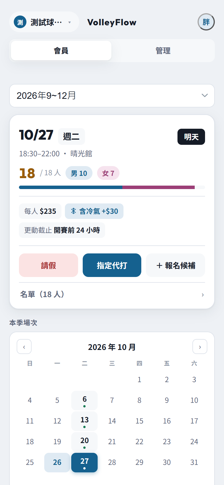
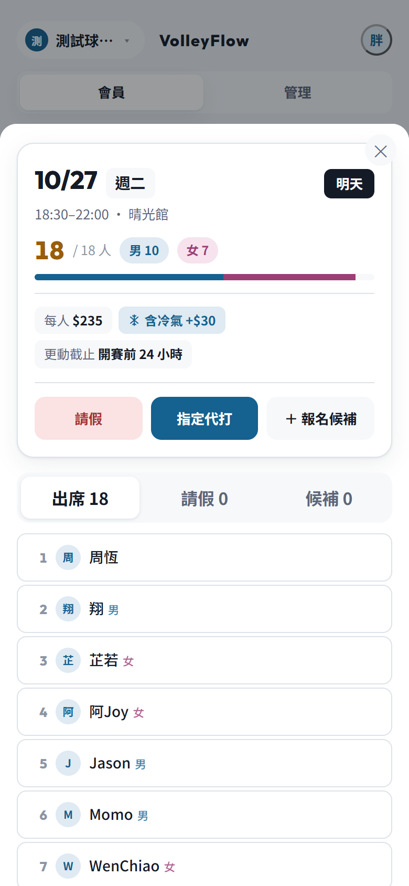
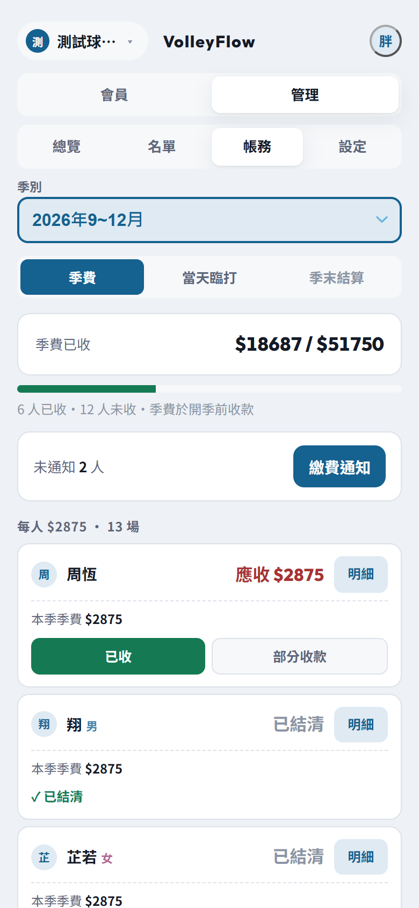
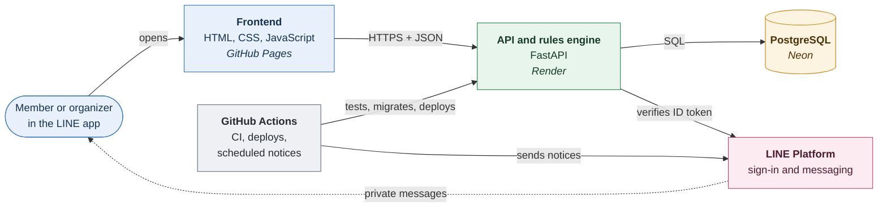

# VolleyFlow

[](https://github.com/marksu1104/volleyflow/actions/workflows/ci.yml)


Signup, waitlist and billing for weekly volleyball games, run inside
LINE. Members take leave, bring a friend or join the queue from their
phone; the organizer runs the roster and the money from the same app.

A real club used to do all of this in a LINE group chat and from memory.
That stops working once a member's absence, the drop-in who fills the
slot, and nights that cost more because the air conditioning ran all
need settling up correctly. VolleyFlow does that bookkeeping with a
deterministic, fully tested rules engine.

<p align="center">
  
  &nbsp;
  
  &nbsp;
  
</p>

## Features

- **Members**: see the season's games and what each costs, take leave
  and name a substitute, sign up guests, join the waitlist when a game is
  full, and check their own balance.
- **Organizers**: manage the roster, record payments, correct a night's
  air conditioning, settle the season, and send each member one fee
  notice.
- **Waitlist**: a freed slot goes to the queue automatically, first come
  first served; the organizer can override the order.
- **Multiple clubs**: anyone can start a club. Each club's roster,
  seasons and books are invisible to every other club.
- **Private notifications**: a few LINE messages at the right moment
  (final roster, promotion off the waitlist, a cancelled game), never to
  the group chat.

## Architecture



The frontend is static files with no build step. The API is stateless,
so the free Render instance can sleep without losing anything; all state
lives in Postgres. The billing engine (`pricing.py`, `settlement.py`,
`ledger.py`) is pure Python with no database access, which is enforced by
`import-linter`.

## Tech stack

| Layer | Choice |
|---|---|
| Backend | Python 3.12, FastAPI, SQLAlchemy 2, Alembic |
| Database | PostgreSQL on Neon |
| Frontend | Plain HTML, CSS and JavaScript, opened through LINE LIFF |
| Notifications | LINE Messaging API |
| Hosting | Render (API), GitHub Pages (frontend) |
| CI and schedules | GitHub Actions |
| Quality | pytest, Node's test runner, Playwright, ruff, mypy --strict, import-linter |

## Key design decisions

- **Costs are split by capacity, not headcount.** A season fee is the
  venue cost divided across the slots on court, so one member leaving
  never re-prices everyone else.
- **The ledger is append-only.** Corrections are new adjustment entries,
  so every balance can be explained by reading its history.
- **Billing never touches the database.** The money rules are pure
  functions, tested exhaustively and kept apart from the web layer by a
  lint rule that fails the build.
- **The club is the tenant boundary.** Every route checks membership,
  and a test sends every route at another club's data to prove it.
- **Production is migrated by CI before each deploy**, and a hand-run
  restore drill proves the backups can actually be restored.

The reasoning behind these, and the incidents that led to several of
them, is in [docs/design-decisions.md](docs/design-decisions.md). The
billing rules are specified in [docs/billing-rules.md](docs/billing-rules.md).

## Getting started

Requires Python 3.12+, [uv](https://docs.astral.sh/uv/), Node.js 20+ and
a PostgreSQL database.

```bash
git clone https://github.com/marksu1104/volleyflow.git
cd volleyflow
uv sync
cp .env.example .env              # set DATABASE_URL
uv run alembic upgrade head
```

Start the API and the pages (Windows PowerShell; bash commands are in
the development guide):

```powershell
.\scripts\dev-api.ps1     # API on :8000, with local sign-in
.\scripts\dev-web.ps1     # pages on :5500
uv run python scripts/seed_dev.py
```

Then open <http://localhost:5500/member.html?as=周恆>. `?as=` signs you
in locally without LINE. See [docs/development.md](docs/development.md)
for sample data, testing on a phone, and how local sign-in is locked
down.

## Testing

```bash
uv run pytest                          # backend: about 650 tests
node --test tests/frontend/*.test.js   # frontend logic: about 340 tests
```

CI also runs ruff, mypy, import-linter, the tests that need a real
Postgres, and a check that the billing modules keep 100% line coverage.
Browser checks with Playwright are run by hand; see
[tests/visual/README.md](tests/visual/README.md).

## Project structure

```
├── src/volleyflow/
│   ├── pricing.py, settlement.py, ledger.py   billing engine (pure Python)
│   ├── schedule.py, players.py, attendance.py domain models
│   ├── api/            FastAPI app, schemas, LINE sign-in, invite tokens
│   │   └── routes/     one module per resource, over shared rule helpers
│   ├── db/             SQLAlchemy models and engine
│   └── notify/         LINE messages and the scheduled jobs
├── frontend/
│   ├── *.html          one page per screen
│   ├── js/common/      shared scripts: API, formatting, the game sheet
│   ├── js/pages/       each page's own script
│   └── css/
├── alembic/            database migrations
├── scripts/            local development, backup and restore
├── tests/              pytest, frontend unit tests, browser checks
└── docs/               billing rules, design decisions, development guide
```

## Deployment

Pushing to `main` runs CI, which applies any pending migrations to
production and then triggers the Render deploy, in that order. The
frontend deploys to GitHub Pages when anything under `frontend/`
changes.

## License

[MIT](LICENSE)
